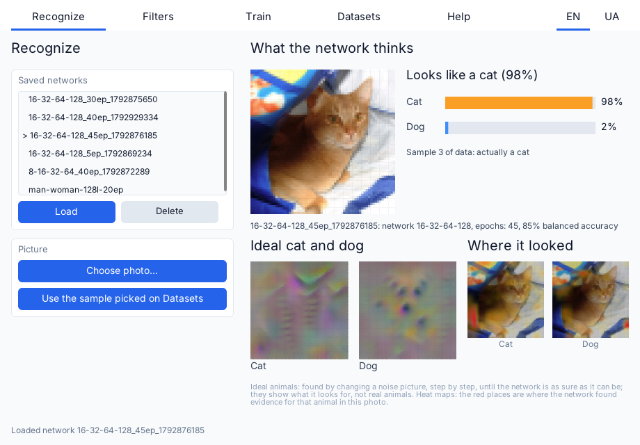
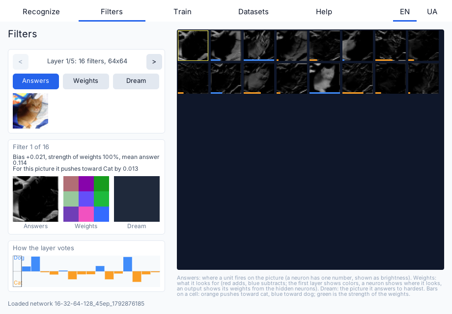
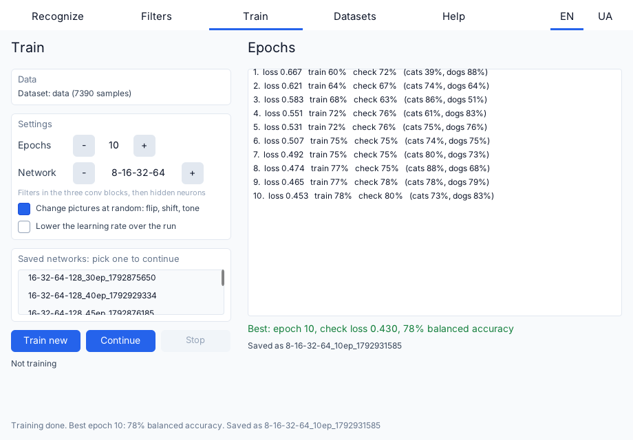
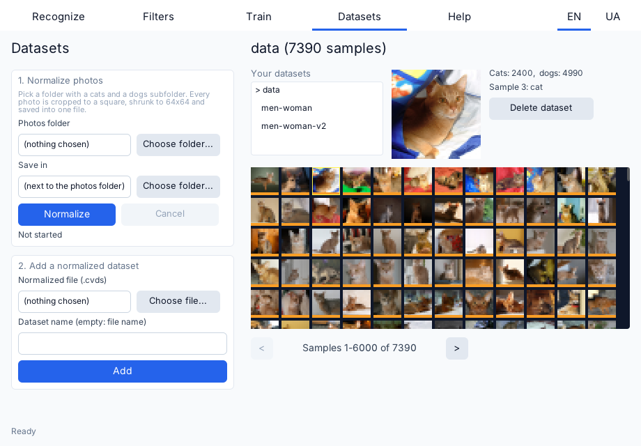
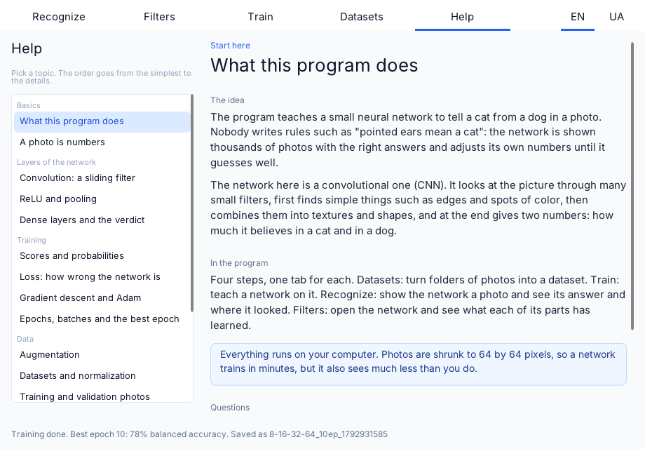

# Cats vs Dogs

An interactive image classifier written in C++23 on top of the [Wind engine](https://github.com/wismh/wind-engine). A small convolutional neural network learns to tell two kinds of pictures apart, cats from dogs by default, and every part of the process is visible: the photos it was trained on, the epochs as they finish, what each filter of the network looks for, and where on a photo the network found its evidence.

The program is also a learning tool. You can turn any two folders of photos into a dataset, train networks of different sizes on it, continue training a saved network, and read a built-in reference that explains the ideas behind each step. The two classes are not fixed to cats and dogs: their names come from the folders the dataset was made from, so the same program tells men from women or anything else that two folders can describe.



## Features

- **Recognize.** Pick a saved network and show it a photo from a file or a sample picked on the Datasets tab. The tab shows the probability of each class, the picture the network sees (64x64), the ideal picture of each class (found by changing a noise image until the network is as sure as it can be), and a heat map per class that shows where the network found evidence on this photo.
- **Filters.** Open the network and look at it layer by layer. Every unit is a picture: a filter of a convolution, a neuron of the hidden layer, or one of the two outputs. Switch between the unit's answer to the current photo, its weights, and its dream (the picture it answers to hardest, found in the background). A chart shows how every unit of a layer pushed the verdict toward one class or the other.
- **Train.** Train a new network or continue a saved one. Choose the number of epochs, the size of the network (three sizes), random changes to the pictures while training (flip, shift, brightness and contrast), and a learning rate that falls over the run. Every epoch is listed as it finishes, with the accuracy on each class. When the run ends the network of the best epoch is saved and handed to the Recognize tab.
- **Datasets.** Turn folders of photos into a normalized dataset file, add it to the app, and browse its samples as a grid of thumbnails. Pick a sample to look at it larger or to send it to the Recognize tab.
- **Help.** A reference in short topics, from how a photo becomes numbers to loss, gradient descent and the best epoch, each with the idea, the formulas and where it appears in the program.
- **Two languages.** The interface and the reference are available in English and Ukrainian; the choice is remembered.

## Screenshots

### Filters



### Train



### Datasets



### Help



## How it works

Every photo is cropped to a square and shrunk to 64x64 pixels with three color channels. The network is built from three blocks, each a 3x3 convolution, a ReLU and a 2x2 max pooling (64x64, then 32x32, then 16x16, down to 8x8), followed by a hidden dense layer with ReLU and a dense layer of two scores that become the two class probabilities. Three sizes are offered, from 4-8-16-32 to 16-32-64-128 (filters in the three blocks, then hidden neurons).

Training is mini-batch gradient descent with Adam (batch of 32, learning rate 0.001) and cross-entropy loss. The dataset is split once into a training part and a validation part (20 percent), and the classes are weighted so that a class with fewer photos counts as much as the other. The numbers shown are the balanced accuracy, the mean of the two classes' accuracies, so a network that answers "dog" to everything does not look good just because there are more dogs. The network of the epoch with the lowest validation loss is the one that is saved.

The seed of the split is stored in the network file, so a network trained further is checked on the same photos it was checked on before. The convolution and dense layers run on a blocked matrix multiplication with an AVX2 kernel and a portable fallback, spread over the engine's worker threads. Training runs in short slices every frame, so the window stays responsive and a run can be stopped at any time.

## Datasets

The program does not ship with photos. Make a folder with exactly two subfolders, one per class, each holding the photos of that class, and use step 1 of the Datasets tab to normalize it into one `.cvds` file. Step 2 adds the file to the app. The names of the subfolders become the names of the classes.

Datasets that fit this layout, on Kaggle:

- [Human faces dataset: male and female classification](https://www.kaggle.com/datasets/hosseinbadrnezhad/human-faces-dataset-male-female-classification)
- [Cats and dogs](https://www.kaggle.com/datasets/yashdogra/cats-and-dogs)
- [The Oxford-IIIT Pet dataset](https://www.kaggle.com/datasets/tanlikesmath/the-oxfordiiit-pet-dataset), also available from [its authors](https://www.robots.ox.ac.uk/~vgg/data/pets/). The screenshots above were made with a set of 2400 cat and 4990 dog photos whose file names are breed names, which matches this dataset. Its photos are not sorted into a cats folder and a dogs folder: sort them first (in this dataset the cat breeds start with a capital letter and the dog breeds with a lowercase one).

Check the license of each dataset before you use it for anything beyond learning.

## Build, run and export

The project is built, run and exported with the Wind Editor, which is part of the [wind-engine](https://github.com/wismh/wind-engine) repository. Get the editor from there and then:

1. Open the Wind Editor and open this folder as a project (it contains `wind_project.toml`).
2. Press **Play**. The editor builds the game module and starts the game.
3. To make a standalone build, use the editor's **Export**.

The project targets the engine version written in `wind_project.toml`. Use the matching Wind SDK.

## Saved files

Datasets and trained networks are stored in the per-user data directory of the game (organization `wismh`, application `cats-vs-dogs`), in the `datasets` and `models` folders, together with the chosen language. Nothing is written into the project folder.

- `.cvds`: a normalized dataset, the names of the two classes, the labels and the 64x64 pictures.
- `.cvm`: a trained network, its size, how long it was trained, its accuracy, the seed of its split and all of its parameters. A file is written beside its final name and renamed, so a failed write never leaves half a file.

## Project layout

```
src/
  model/        The domain: network, layers, training, evaluation, augmentation, dreams, heat maps,
                file formats and stores. Has no engine dependencies.
  kernels/      Matrix multiplication (AVX2 and portable) and the layer operations built on it.
  view/         Painters and view-model items for the UI.
  help/         The reference tab.
  loc/          Localization helpers.
  normalizer.*, dataset_manager.*, trainer.*, recognizer.*, filter_panel.*, model_library.*, train_settings.*
                The behavior of each tab, one responsibility each.
assets/         UI (XML and CSS), strings, help topics.
tools/          Generators of the help topics and of the strings.
tests/          Unit tests of the domain.
docs/           Screenshots.
```

The domain code in `src/model` is built as a separate static library, `pets_model`, which the game module and the tests both link.

## Tests

The domain has unit tests (GoogleTest, taken from the Wind SDK) for the layers and their gradients, the matrix kernels, Adam, the loss, training and its determinism, augmentation, the dataset and model file formats and stores, the filter views, heat maps, dreams and the rules that decide how a saved network is continued. They are off by default so that building in the editor does not compile them. To build and run them, configure with the `tests` preset and pass the path to the Wind SDK:

```
cmake --preset tests -DCMAKE_PREFIX_PATH=<path to the Wind SDK>
cmake --build build-tests --config Release
ctest --test-dir build-tests -C Release
```
